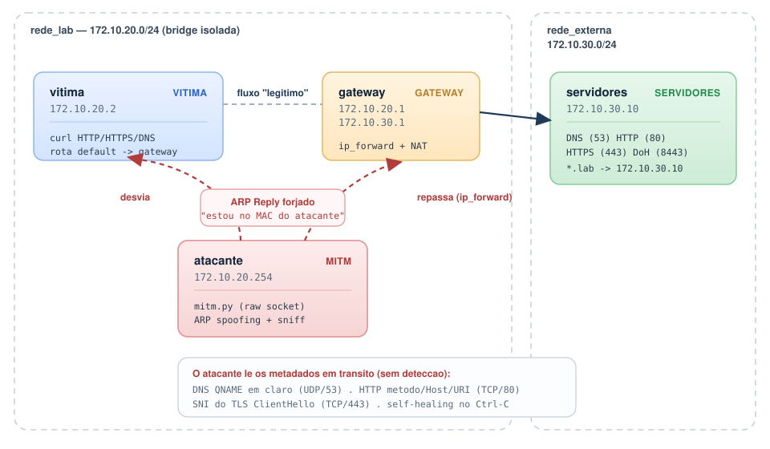

# Trabalho Final — Man-in-the-Middle com ARP Spoofing

Laboratório de Redes (PUCRS, 2026/2). A máquina **atacante** se posiciona entre a
**vítima** e o **gateway** da rede local via **ARP Spoofing**, mantém o
encaminhamento transparente (`ip_forward`) e **audita os metadados** do tráfego
web: DNS em claro (UDP/53), HTTP (TCP/80) e o domínio vazado pelo **SNI** do
HTTPS (TCP/443).

Toda a manipulação de pacotes é feita com **raw sockets** (`AF_PACKET`) e
decodificação própria byte a byte — **sem** Scapy, arpspoof, ettercap ou
libpcap/tcpdump, como exige o enunciado. Só usa a **biblioteca padrão do Python 3**.

> ⚠️ **Ambiente 100% isolado.** Tudo roda em contêineres numa rede privada, sem
> contato com redes reais. Rodar ARP Spoofing em rede de terceiros é crime
> (Seção 10 do enunciado).

📖 Conceitos e arquitetura interna: [`docs/arquitetura.md`](docs/arquitetura.md) ·
Experimentos e relatório: [`docs/relatorio.md`](docs/relatorio.md)

---

## 🚀 Início rápido

### Pré-requisito (só na primeira vez)

O Podman precisa rodar em **modo rootful** — sem isso o `gateway` não sobe e a
varredura ARP não acha ninguém. No **macOS/Windows** o Podman roda numa VM Linux;
rode os comandos abaixo, um a um (no **Linux nativo**, pule isto e use `sudo`).

Cria a VM (só se você nunca criou):

```bash
podman machine init
```

Para a VM para poder trocar o modo:

```bash
podman machine stop
```

Habilita o modo rootful:

```bash
podman machine set --rootful
```

Liga a VM:

```bash
podman machine start
```

Fica salvo. Nas próximas sessões basta `podman machine start` (reiniciar o PC desliga a VM).

### Rodar o lab

Use **2 terminais no Mac**, na raiz do projeto.

**Terminal 1** — sobe os 4 contêineres:

```bash
./scripts/lab.sh up
```

Confira que subiram `vitima`, `atacante`, `gateway` e `servidores` (todos `Up`):

```bash
podman ps
```

**Terminal 2** — entra no atacante (o prompt vira `root@...:/lab#`):

```bash
./scripts/lab.sh shell atacante
```

Já **dentro do contêiner**, inicia o ataque:

```bash
python3 /lab/src/mitm.py --iface eth0 --vitima 172.10.20.2 --gateway 172.10.20.1
```

**Terminal 1** — começa a captura da evidência:

```bash
./scripts/lab.sh capture start captura_auditoria.pcapng
```

Gera o tráfego na vítima (veja o painel reagir no Terminal 2):

```bash
./scripts/lab.sh trafego tudo
```

Fecha o `.pcapng` em `resultados/`:

```bash
./scripts/lab.sh capture stop
```

### Encerrar

No **Terminal 2** (dentro do atacante), `Ctrl-C` restaura as caches ARP e o `ip_forward`. Depois, no **Terminal 1**:

```bash
./scripts/lab.sh down
```

**Onde cada comando roda — a regra de ouro:**

| Comando | Onde |
|---|---|
| `./scripts/lab.sh ...` (`up`/`down`/`shell`/`capture`/`trafego`) | sempre **no Mac** |
| `python3 /lab/src/mitm.py ...` | **dentro do atacante** (depois do `shell atacante`) |

🔍 **Wireshark no navegador:** <http://127.0.0.1:6080/> — abre o Wireshark do
atacante já capturando em `eth0` (filtro `ip or arp`). A evidência em `.pcapng`
**não depende** dessa aba: quem grava é o `capture start`.

---

## Topologia

<p align="center">
  
</p>

```
  rede_lab — 172.10.20.0/24                      rede_externa — 172.10.30.0/24
 ┌───────────────────────────────────┐          ┌────────────────────────────┐
 │  vitima .20.2 ──rota default──┐    │          │                            │
 │                               ▼    │          │                            │
 │  atacante .20.254 ◄══ARP══► gateway .20.1 / .30.1 ──NAT──► servidores .30.10│
 │     (mitm.py)                      │          │   DNS · HTTP · HTTPS · DoH  │
 └───────────────────────────────────┘          └────────────────────────────┘
```

| Papel | Contêiner | IP | Programa |
|---|---|---|---|
| Vítima | `vitima` | 172.10.20.2 | gera tráfego (`curl`) |
| Atacante (MITM) | `atacante` | 172.10.20.254 | `src/mitm.py` + Wireshark |
| Gateway | `gateway` | 172.10.20.1 / 172.10.30.1 | roteamento (`ip_forward` + NAT) |
| Servidores | `servidores` | 172.10.30.10 | DNS + HTTP + HTTPS(SNI) + DoH |

A vítima roteia pelo gateway; o atacante, na mesma `rede_lab`, envenena as caches
ARP da vítima e do gateway para entrar no caminho em nível 2 e enxergar todo o
tráfego dela. Os servidores ficam **depois** do gateway de propósito — é o que dá
sentido ao Experimento 3 (sem encaminhamento, o tráfego da vítima não chega lá).
Todos os domínios `.lab` resolvem para `172.10.30.10`, diferenciados pelo Host/SNI.

---

## A aplicação (`src/mitm.py`)

1. **Descoberta** — varredura ARP lista os nós ativos (IP/MAC) e seleciona vítima e gateway.
2. **Envenenamento bidirecional** — `ARP Reply` forjados periódicos enganam vítima e gateway.
3. **Encaminhamento** — mantém `ip_forward=1` para a vítima não perder conexão.
4. **Captura e decodificação** — raw socket desmonta Ethernet/IPv4/UDP/TCP e extrai DNS (QNAME), HTTP (método/Host/URI) e SNI (TLS `ClientHello`).
5. **Persistência + painel** — grava `captura_*.log` e `resumo_*.csv` e mostra um painel em tempo real.
6. **Self-healing** — no `Ctrl-C`, restaura as caches ARP verdadeiras e o `ip_forward`.

Sem `--vitima/--gateway`, o programa varre a rede e pergunta os alvos. Threads,
filas e sincronização estão em [`docs/arquitetura.md`](docs/arquitetura.md).

---

## Os três experimentos

A vítima gera o tráfego via `./scripts/lab.sh trafego ...` (no Mac). Detalhes e o
que apresentar: [`docs/relatorio.md`](docs/relatorio.md).

| # | Comando | O que demonstra |
|---|---|---|
| 1 | `trafego http` e `trafego https` | HTTP expõe tudo (método, URI, cookies); HTTPS só o SNI |
| 2 | `trafego dns` e depois `trafego doh` | correlação DNS→SNI; com DoH a consulta UDP/53 some, mas o SNI continua exposto |
| 3 | no atacante: `echo 0 > /proc/sys/net/ipv4/ip_forward` | a espionagem vira blackhole (a vítima perde conexão) |

No Experimento 3, reative com `echo 1 > /proc/sys/net/ipv4/ip_forward` (ou suba o
`mitm.py` já com `--sem-forward`).

---

## Conferir a evidência

- **Gerada pelo programa** (`resultados/`): `captura_*.log` (um evento por linha) e `resumo_*.csv` (destinos consolidados: domínio, IP, protocolos, bytes).
- **Captura do Wireshark:** `resultados/captura_auditoria.pcapng`. Abra em <http://127.0.0.1:6080/> ou no Wireshark do seu Mac. Filtros úteis: `arp`, `dns`, `http`, `tls.handshake.type == 1`.

**Testar sem subir o lab** (offline, sem root/rede/contêineres):

```bash
python3 scripts/autoteste.py
```

Valida os parsers (Ethernet/ARP/IPv4/UDP/TCP/DNS/HTTP/SNI) e gera exemplos em
`resultados/captura_exemplo-autoteste.log` e `resumo_exemplo-autoteste.csv`.

---

## 🛠️ Se der problema

| Sintoma | Causa | Solução |
|---|---|---|
| `Cannot connect to Podman... connection refused` | VM do Podman desligada (reiniciar o PC desliga). | `podman machine start` e repita. |
| `podman ps` mostra só 3 contêineres (falta `gateway`); `ping 172.10.20.1` falha; `mitm.py` diz `Nao consegui resolver o MAC` | Podman em modo **rootless**. | Refaça o setup rootful do Início rápido e `./scripts/lab.sh up`. |
| `No such file or directory` ao rodar `./scripts/lab.sh ...` | Você está **dentro do contêiner**. | Rode `lab.sh` num terminal **do Mac**, na raiz do projeto. |
| Wireshark (`127.0.0.1:6080`) abre **preto / vazio** | Imagem do atacante **antiga** (antes da correção de renderização Qt sobre VNC). | `./scripts/lab.sh down && ./scripts/lab.sh up` para **reconstruir** a imagem. Depois recarregue a aba (F5). |
| Aba preta **mesmo após reconstruir** | Wireshark não subiu. | `podman logs atacante \| grep start-wireshark` mostra o motivo (ex.: interface ausente). O `.pcapng` segue sendo gravado pelo `capture start`, independente da GUI. |

Diagnóstico rápido (dentro do atacante): `ping -c2 172.10.20.1` tem que responder
— se responder, a varredura ARP acha os alvos.

> **Nota sobre a tela preta:** a interface gráfica roda dentro do atacante
> (Xvfb → x11vnc → noVNC) e era servida com o MIT-SHM do Qt ligado, o que fazia o
> Wireshark desenhar preto sobre o VNC; além disso a janela abria pequena no meio
> de um desktop preto. A correção (`QT_X11_NO_MITSHM`, `-noxdamage` no x11vnc e
> Wireshark iniciando maximizado) está na imagem — por isso é preciso
> **reconstruir** (`up` reconstrói) se o lab já estava no ar.

---

## Estrutura do repositório

```text
TF_Lab_Redes/
├── compose.yaml                 4 contêineres (vitima, atacante, gateway, servidores), 2 redes
├── scripts/
│   ├── lab.sh                   orquestra o lab (up/down/shell/capture/trafego)
│   ├── gerar-trafego.sh         tráfego da vítima (http/https/dns/doh)
│   └── autoteste.py             testes offline dos decoders + pipeline
├── containers/                  imagens: atacante (Wireshark/noVNC), vitima, gateway, servidores
├── src/
│   ├── decoders.py              parsers byte a byte (Ethernet/ARP/IP/UDP/TCP/DNS/HTTP/SNI)
│   ├── arp.py                   raw socket, descoberta, envenenamento, cura
│   ├── interceptador.py         estado compartilhado, correlação, persistência
│   ├── tui.py                   painel em tempo real
│   └── mitm.py                  APLICAÇÃO PRINCIPAL (orquestra tudo)
├── docs/
│   ├── topologia.svg            diagrama da topologia e do ataque
│   ├── arquitetura.md           threads, filas, sincronização, conceitos
│   ├── relatorio.md             esqueleto do relatório (3 experimentos + análise)
│   └── evidencias/              capturas de tela dos experimentos
└── resultados/                  pcapng, captura_*.log e resumo_*.csv
```

---

## Entregáveis (Seção 7 do enunciado)

- **Código-fonte comentado:** `src/` (+ infra em `containers/` e `scripts/`).
- **Instruções do ambiente:** este README + `compose.yaml` + `containers/`.
- **Dados de evidência:** `resultados/captura_auditoria.pcapng`, `captura_*.log`, `resumo_*.csv`.
- **Relatório técnico (PDF):** exportar `docs/relatorio.md` preenchido com as evidências da sua execução.
